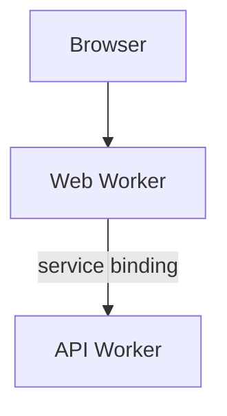

## One infrastructure graph

`infra/alchemy.run.ts` composes deployment configuration, the Worker graph, and the web application. Resource objects carry their outputs and types into downstream bindings.

The platform currently hosts one web app: Adishwar Rishi's personal website in `apps/web`, a TanStack Start app that Alchemy deploys as a Cloudflare Website. The web Worker has a service binding to the API Worker, which has no public `workers.dev` URL and serves no routes yet. The stack declares no databases, buckets, or queues. Alchemy supplies local implementations of the same graph during development and integration tests.

| Path                                | Owns                                             |
| ----------------------------------- | ------------------------------------------------ |
| `infra/src/worker-bindings.ts`      | Runtime bindings and derived environment types   |
| `infra/src/workers.ts`              | Workers, their crons, and their queue consumers  |
| `infra/src/web-application.ts`      | TanStack Start's Alchemy Website resource        |
| `packages/contracts/src/transport/` | Effect RPC over a service binding                |
| `apps/web/src/routes/`              | URLs, route loaders, and HTTP handlers           |
| `apps/web/src/server/`              | Server-side calls from the web app to the API    |
| `packages/contracts/`               | Shared schemas, tagged failures, and RPC helpers |

## Worker-to-Worker RPC

Each Worker is a plain module. Its default export handles HTTP, cron, and queue events, and each caller gets its own `WorkerEntrypoint` serving one RPC group from `@repo/contracts`.

`worker-bindings.ts` binds an entrypoint with `Cloudflare.WorkerEntrypoint(worker, "Name")`. The caller builds a client with `clientOverBinding(group, { binding, service, timeout })`, and the entrypoint answers with `rpcWebHandler(group, handlers)`. Arguments, results, and tagged failures pass through the group's schemas, so a remote failure keeps its tag. A transport failure or missed deadline arrives as `RpcClientError`. Cancellation interrupts the caller's local Effect but does not stop work already executing in the receiving Worker.

To add a method, add it to the caller's group and handle it in the entrypoint's handler layer.

Bindings between plain modules can't form a cycle. If one Worker calls another, the callee never calls back.

## Add a runtime

Add web apps under `apps/` and Workers under `workers/`. Keep their application behavior in those workspaces and declare infrastructure under `infra/`.

Define bindings in `worker-bindings.ts`, add the Worker to `workers.ts`, and test through its public HTTP or RPC interface. Alchemy owns bundling, migrations, queue delivery, and local emulation; individual runtimes have no separate Wrangler configuration.

Keep each database's migrations beside its owning app or Worker, such as `workers/api/migrations/`. Other runtimes use the owner's API to access its data. Declare and provision the database under `infra/`, pointing its `migrations` option at that directory.

Keep resource logical IDs stable when moving declarations between files. Alchemy uses those IDs to identify existing resources across deployments.
